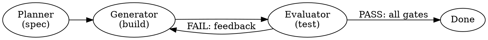

# Dark Factory Mode

## Overview

**Dark factory** = a production line that runs lights-out, with no humans on the floor.

Applied to Claude Code: a harness pattern where **generation and evaluation are separated into distinct agents/phases**, each with hard quality gates, so the loop can keep running — and self-correcting — without a human in the chair.

Core principle from Anthropic's harness design research: *agents exhibit leniency bias when evaluating their own work*. Separating generation from evaluation, and tuning the evaluator toward skepticism, is far more tractable than making a generator self-critical.

---

## When to Use

- Building a WebUI feature end-to-end and you want to walk away
- Any multi-sprint implementation where quality must be maintained across iterations
- When you'd otherwise need to babysit Claude between each step
- Long-running tasks (>30 min) where context anxiety causes premature completion

**NOT for:**
- Single-file edits or trivial fixes (overhead not worth it)
- Tasks where human judgment on design/UX is the primary bottleneck

---

## The Three-Agent Loop



### Planner
- Input: 1–4 sentence user prompt
- Output: Full product spec (written to file)
- Bakes in: tech stack, acceptance criteria, design principles
- **Never** specifies granular implementation details — that causes cascading errors

### Generator
- Reads spec, implements in sprints
- Writes a **sprint contract** before each sprint (see below)
- Commits to git after each sprint
- Does NOT self-evaluate quality — hands off to Evaluator

### Evaluator
- Tests the running app via interactive tools (Playwright, curl, etc.)
- Grades against the sprint contract's hard thresholds
- If ANY gate fails → writes detailed failure report (file path + root cause) → returns to Generator
- If ALL gates pass → marks sprint complete, advances

---

## Sprint Contracts

Before each sprint, Generator and Evaluator **negotiate** what "done" means:

```
Sprint N Contract
─────────────────
Feature: [user story]
Deliverables:
  - [ ] Specific UI element X renders
  - [ ] API endpoint Y returns status 200 with shape Z
  - [ ] DB row created with fields A, B, C
Acceptance threshold: ALL items must pass (no partial credit)
```

**Why contracts matter:** They translate vague user stories into verifiable, binary pass/fail criteria. The Evaluator can only be skeptical if it has a concrete spec to be skeptical against.

---

## Communication Pattern

Agents communicate through **structured files**, not conversation:

```
spec.md          ← Planner writes
sprint-N.md      ← Generator proposes contract
sprint-N.md      ← Evaluator countersigns or redlines
build-log.md     ← Generator appends progress
eval-report-N.md ← Evaluator writes findings
```

This prevents context degradation across agent transitions and creates a permanent audit trail.

---

## Quality Gates (Hard Thresholds)

Each criterion has a binary pass/fail threshold. Suggested gates for WebUI:

| Gate | Tool | Fail condition |
|------|------|----------------|
| UI renders without crash | Playwright screenshot | Any JS error in console |
| Core user flow completes | Playwright interaction | Flow blocked or 4xx/5xx |
| API contract met | curl / fetch | Shape mismatch or error status |
| No regressions | Re-run prior sprint tests | Any previously-passing test now fails |

**Hard rule:** A single gate failure = sprint fails. No partial acceptance.

---

## Failure Mode Handling

| Failure Mode | Symptom | Fix |
|---|---|---|
| Self-evaluation bias | Evaluator approves mediocre work | Tune evaluator prompt toward skepticism; give it Playwright access |
| Context anxiety | Generator declares "done" prematurely | Reset context window; use structured handoff files |
| Context loss | Incoherent implementation mid-sprint | Explicit context resets with structured summaries |
| Superficial testing | QA misses edge cases | Iterative prompt refinement; review eval vs human judgment divergences |
| Spec drift | Implementation diverges from spec | Evaluator checks against original spec.md, not just sprint contract |

---

## Implementation Checklist

**Setup phase:**
- [ ] Write `spec.md` (Planner output or human-authored)
- [ ] Define quality gate criteria upfront
- [ ] Confirm Playwright / test tooling available

**Each sprint:**
- [ ] Generator writes sprint contract to `sprint-N.md`
- [ ] Evaluator countersigns (or redlines) contract
- [ ] Generator implements, commits to git
- [ ] Evaluator runs all gates against live app
- [ ] If FAIL: evaluator writes `eval-report-N.md` with file:line citations
- [ ] Generator reads report, fixes, re-runs evaluator
- [ ] If PASS: advance to next sprint

**Completion:**
- [ ] All sprint contracts marked PASS
- [ ] Final evaluator runs full regression suite
- [ ] Human reviews `eval-report-*.md` logs (strategic, not continuous)

---

## Prompting Principles

**Evaluator prompt must:**
- Be explicitly skeptical ("assume the implementation is broken until proven otherwise")
- Reference the sprint contract by file path
- Require file:line citations for any failure
- Forbid partial acceptance ("all gates must pass, not most")

**Generator prompt must:**
- Read the sprint contract before writing any code
- Commit to git after each sprint (creates rollback points)
- Write eval-readable build logs (what was built, what was intentionally skipped)

**Design quality phrases that work:**
- "Museum quality aesthetics" (raises bar on UI craft)
- "Explicitly reject AI slop patterns" (prevents generic filler UI)
- Concrete rejection criteria beat vague aspirations

---

## Cost/Quality Trade-off

From Anthropic's research (retro game maker example):
- Single-agent: ~$9, lower quality
- Dark factory (Opus 4.5, 6 hrs): ~$200, significantly higher quality
- Dark factory (Opus 4.6, <4 hrs): reduced cost, comparable quality

**Sprint decomposition becomes optional as models improve.** Strip scaffolding when capability makes it overhead — the generator-evaluator separation remains valuable even as other structure is removed.

---

## Red Flags — Loop Is Breaking Down

- Evaluator approves work with visible bugs → evaluator prompt too lenient
- Generator keeps hitting same failure → feedback report lacks file:line specificity
- Loop runs >10 iterations on same sprint → spec is ambiguous; redraft sprint contract
- Generator declares "complete" without evaluator sign-off → context anxiety; reset and re-handoff
- Files growing unbounded → implement log rotation or summary files

---

## The Bottom Line

**Separate generation from evaluation. Hard gates, not soft suggestions. Files as handoffs, not conversation. Human reviews logs, not live output.**

This is the minimum structure needed for a Claude Code session to run lights-out and deliver quality work without someone watching every step.
